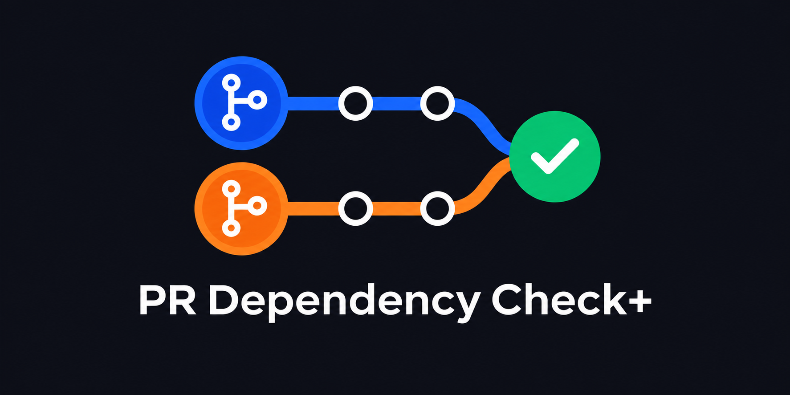

This GitHub Action enforces PR dependencies declared in discussion comments or the PR description.

PR Dependency Check+ is a separately maintained fork of [PR Dependency Check](https://github.com/gregsdennis/dependencies-action), enhanced to add and update PR discussion comments showing dependency status. Credit for the original action goes to its maintainers and contributors.

The action searches discussion comments for the key phrases "depends on" or "blocked by" followed by a reference (e.g. `Depends on #5`). It uses the first comment containing dependencies. If no comment contains dependencies, it reads the PR description instead. Review comments on individual code lines are not scanned.

## Dependency status comment

The action updates the existing comment marked with `<!-- pr-dependencies -->`. If there is no marked comment, it adds the status section to the discussion comment containing dependencies, preserving the original text. If dependencies were found only in the PR description, it creates a status comment. Subsequent runs reuse that comment.

The status section includes a dependency table with titles, a warning listing unresolved dependencies, and the last checked time in UTC. Once all dependencies are merged, the warning becomes:

```markdown
> [!TIP]
> **All dependencies merged.** This PR is clear of dependency blockers.
```

Only merged pull requests count as resolved. Closed but unmerged PRs, issue references, and dependencies that cannot be fetched remain blockers. Repeated references to the same dependency are shown once. No comment is created when no dependencies are declared.

The marker reserves the rest of the comment for the generated status section. Keep dependency declarations and other text above it. Dependencies are refreshed when the workflow runs; merging a dependency in another PR does not itself rerun this PR's workflow.

## Supported link styles

The action can detect links in the following styles:

- Quick Link: `#5`
- Partial Link: `scoobs-mystery-bytes/dependencies-action-plus#5`
- Partial URL: `scoobs-mystery-bytes/dependencies-action-plus/pull/5`
- Full URL: `https://github.com/scoobs-mystery-bytes/dependencies-action-plus/pull/5`
- Markdown: `[markdown link](https://github.com/scoobs-mystery-bytes/dependencies-action-plus/pull/5)`

Issue references are detected and reported, but must be replaced with pull request references to resolve the dependency check.

Also supports custom domains for use with GitHub Enterprise!

## Example usage

Just add the following to a `.yml` file in your `.github/workflows/` folder.

```yaml
name: dependencies-action-plus

on:
  pull_request_target: 
    types: [opened, edited, closed, reopened]
  issue_comment:
    types: [created, edited, deleted]

permissions:
  issues: write
  pull-requests: read

jobs:
  dependencies_action_plus:
    if: >-
      github.event_name != 'issue_comment' ||
      (github.event.issue.pull_request && github.event.sender.type != 'Bot')
    runs-on: ubuntu-latest
    name: dependencies-action-plus
    steps:
    - uses: scoobs-mystery-bytes/dependencies-action-plus@main
      with:
        custom-domains: my-custom-domain.io another.domain.com
      env:
        GITHUB_TOKEN: ${{ secrets.GITHUB_TOKEN }}
```

Run `npm test` from the repository root.

### Permissions and the GitHub Token

This action interacts with the GitHub API, which requires the use of a token.

The token needs `issues: write` to create and update discussion comments, and `pull-requests: read` to check merge status. The example also refreshes dependencies when a person creates, edits, or deletes a PR discussion comment. Bot comment events are skipped to avoid triggering the workflow from its own updates.

The standard `secrets.GITHUB_TOKEN` (as shown above) can be used when accessing issues and PRs on public repositories.

When your dependencies are issues or PRs found in private repositories, a [Personal Access Token](https://docs.github.com/en/authentication/keeping-your-account-and-data-secure/managing-your-personal-access-tokens#creating-a-fine-grained-personal-access-token) (PAT) is required.  This PAT must have access to the target repositories.
